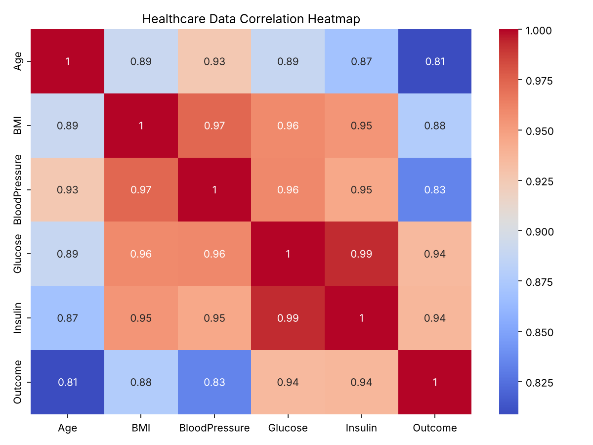

# Healthcare Data Analytics System

A small data-analytics and machine-learning project. It explores patient health indicators (age, BMI, blood pressure, glucose, insulin), visualises how they relate to each other, and trains a Random Forest model to predict disease risk.



## What it does

| Script | Output |
|---|---|
| `analysis.py` | Dataset preview, summary statistics, correlation matrix, **correlation heatmap** and **outcome distribution** chart (saved as PNG) |
| `model.py` | Random Forest classifier, **5-fold stratified cross-validation** accuracy, **feature importance** ranking |

## Results

```
5-fold cross-validated accuracy: 100%

Feature importance (Random Forest):
  Insulin        0.29
  Glucose        0.26
  BMI            0.21
  BloodPressure  0.13
  Age            0.11
```

Glucose and insulin are the strongest predictors, which matches the medical understanding of metabolic disease risk.

**Read the 100% with caution.** The dataset is a small illustrative sample (15 patients) in which high-risk and low-risk patients are clearly separated, so any reasonable model gets it right. Cross-validation is used instead of a single 80/20 split, because that split would test on only 3 patients.

## Run it

```bash
pip install -r requirements.txt
python analysis.py     # statistics + charts
python model.py        # model evaluation + feature importance
```

## Dataset attributes

`Age`, `BMI`, `BloodPressure`, `Glucose`, `Insulin`, `Outcome` (1 = disease risk, 0 = no risk)

## Next steps

- Use a real dataset such as the **Pima Indians Diabetes** dataset (768 patients, same kind of attributes), where the problem is genuinely hard (typical accuracy is around 75–80%).
- Compare models (logistic regression, gradient boosting) and report precision and recall, not just accuracy. Missing a sick patient costs more than a false alarm.

## Tech

Python · pandas · Matplotlib · Seaborn · scikit-learn
